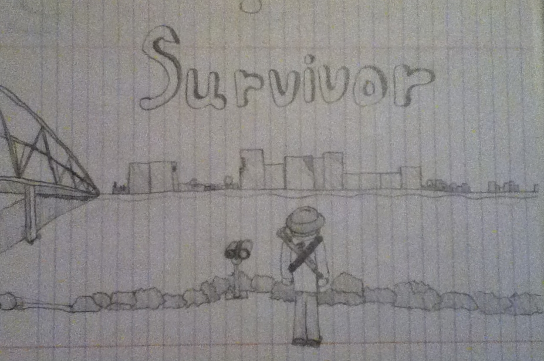
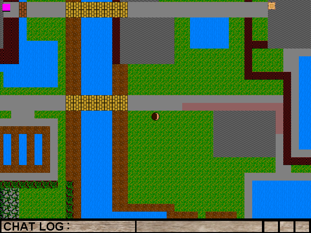
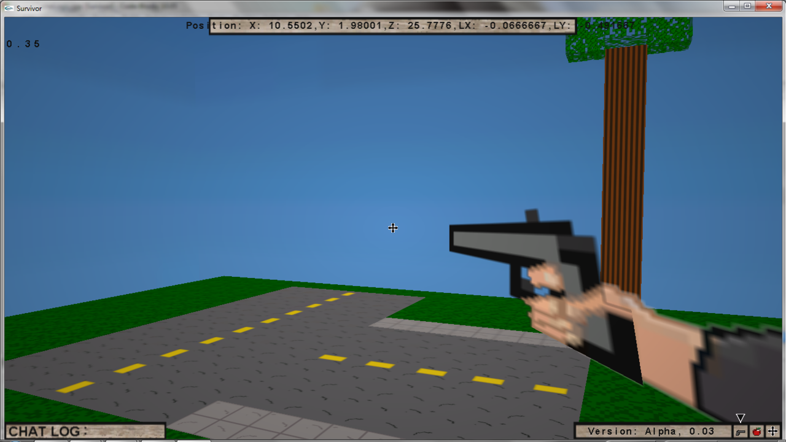
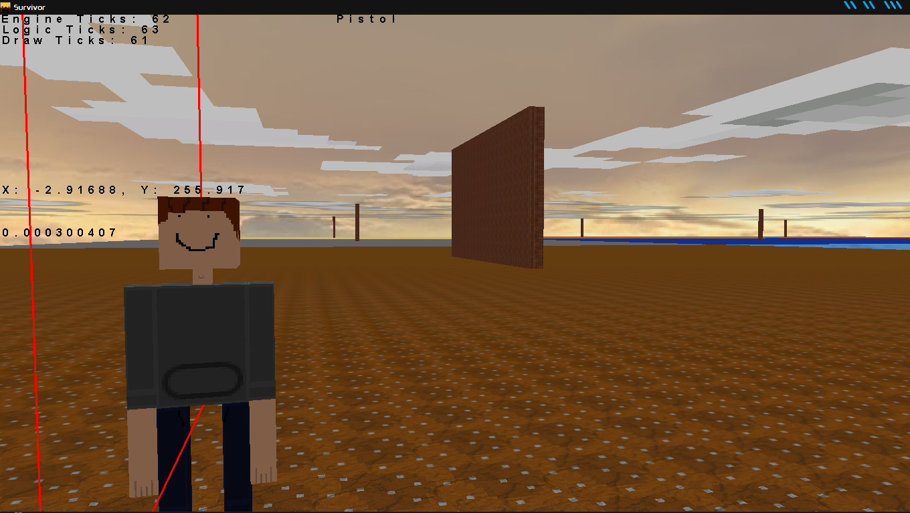
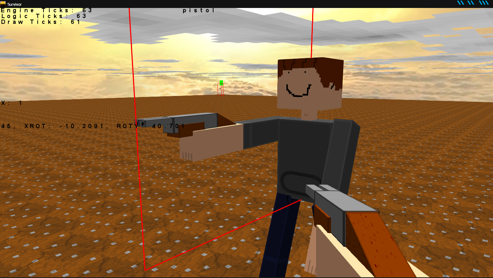

After messing around with scripting on various sandbox games, I wanted to have the freedom of running scripts and code without a large runtime framework that required lots of resources and an internet connection. I did some research on what frameworks were available for 2D lua games, and one stood out as a potential solution: Love2D. After maybe a year or two of this, I realized it was not efficient enough for the kind of game I wanted to make, so I had to start from square one: an efficient programming language that can make games and run on low end machines, which meant C++. After learning C++ I continued developing the game and different features, learning about software architecture and computer graphics along the way. I stopped working on the project when I had other ideas for games using the same C++ base engine but new art assets and lua scripts.

## Screenshots

### Lua

The [Love2D](https://love2d.org/) engine provides a lot of things for free, so I mostly worked on a game orchestration app. The physics and rendering were the most limiting factors in further developing this game. It did allow me to learn how game and software states are orchestrated, how to write GUI applications, and physics simulations in games.

> [LÖVE (Love2D)](https://love2d.org/) is a free, open-themed, and lightweight 2D game framework built on Lua and C++

### C++

With C++ I was essentially starting from scratch, though I did start with [SDL](https://www.libsdl.org/) which provided a decent amount of basic video-game / app functionality for free.
> [Simple DirectMedia Layer (SDL)](https://www.libsdl.org/) is a cross-platform software development library that provides low-level access to audio, keyboard, mouse, joystick, and graphics hardware.

### Survivor Engine
After years of developing different proof of concept games and hackathon submissions on top of the engine, I had a repository of code that had many advantages and disadvantages over other game engines. The main limiting factor was the bugs resulting from learning the quirks of C++ / C while writing a multi-platform game engine. Any small mistake in memory management could crash the entire app or even disrupt the host machine, and it could be instantly and un-capturable or slow and unpredictable in timing and source. Another pain was OpenGL versioning and supporting different hardware, as different pieces of the machine can affect a lot of how the engine runs. I had considered rewriting the entire engine in Java or Kotlin or a web app between 2015 and 2018.

## Lessons Learned
I had started reaching a "height limit" with my knowledge at the time in 2013, mainly around math beyond trig and geometry.Essentially, I really needed to learn calculus, statistics, physics, and more about information/computation theory to make simulated 3D environments that can sync over the internet.