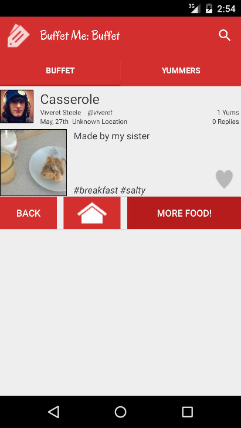
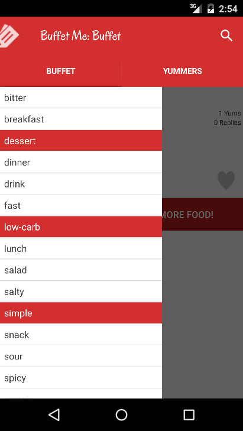
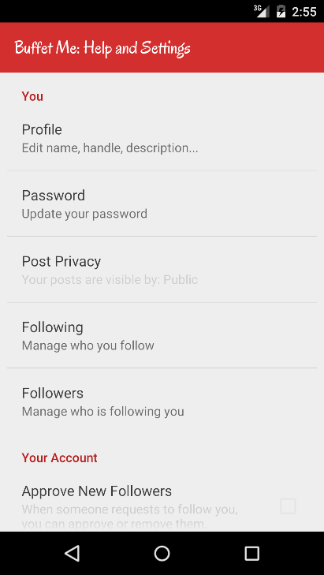

I was inspired by how so many people post food pictures on social media but without a recipe. Additionally, a lot of recipe websites do not easily convert measurements or sizing (sometimes it is because the recipe does not scale exactly, but this could be solved by software). If the wider view goal of it being a kind of social-media site did not work out and I was the only user, then I could use it to track, search, and manage my own recipes.

## Tech Stack
- App: Java, Android SDK
- Server: PHP, SQL

## Architecture
- App: Login or Register Activity -> Main Activity which can show Following posts or Search. Profiles and posts are loaded as needed by the server via JSON API.
- Server: Simple PHP API for CRUD users, posts, tags, followers.

## Screenshots
||||
|-|-|-|
||||

## Reception
I never fully completed the app, so the beta was never finished which would have opened registration to the public. The early feedback I received was that it was a fun idea app and there was some value in being able to search for recipes and change portion size but that the social media aspect of it was not as useful and maybe a little distracting.

## Lessons Learned
I learned how a simple social media site works, how search works, and how a client/server architecture works for mobile apps. The data model and relationships shapes how the app functions which has a major influence on the usability to the general public. As for managing my own recipes, today in 2026 I would have recipes saved as markdown or JSON files in a folder in my documents so it is easily accessible and searchable, but I can also write a front end view to manage them or incorporate it into my existing Information Management System.