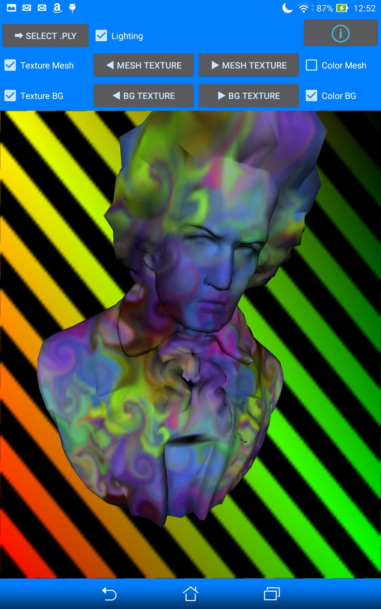
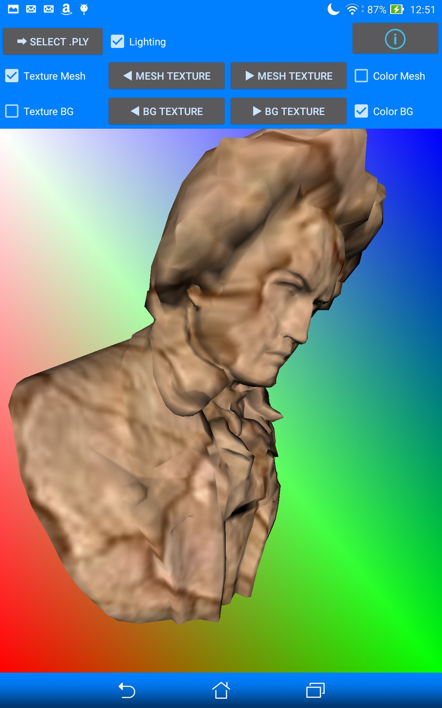

I went to a hackathon in 2016 called the "XPRT Women Code-A-Thon" for students to develop resource intensive applications using or for the benchmarking tool suite. My idea was to utilize my computer graphics knowledge to develop a GPU benchmarking tool. 

[Link to the hackathon event page](https://www.principledtechnologies.com/benchmarkxprt/codeathon/2016/)

[Link to code repository](https://github.com/viveret/XPRT_Winter_2016)

|||
|-|-|
|||

## Tech Stack
Android SDK + NDK, Kotlin, C++

## App Features
- Load mesh data from PLY and other supported formats
- Different options for color and texture of background and mesh
- Lighting toggle
- Touch screen to rotate mesh
- A few test meshes included by default

## Architecture
- Main Activity with a rendering canvas using GLES
- GUI for manipulating and viewing the render options and render state
- GPU shaders that take the render options and state to render the intended view

## Reception
My app was received well at the competition and I won 1st place. I later took the app and made a few changes before releasing it to the Google Play Store. Users on the app had problems with file/folder permissions and I think at some point I lost the app signing keys, so the app was eventually unpublished.

## Lessons Learned
I think a web version would have been better in the long term as Android apps require constant maintenance and fixes, whereas browser GPU passthrough is stable.