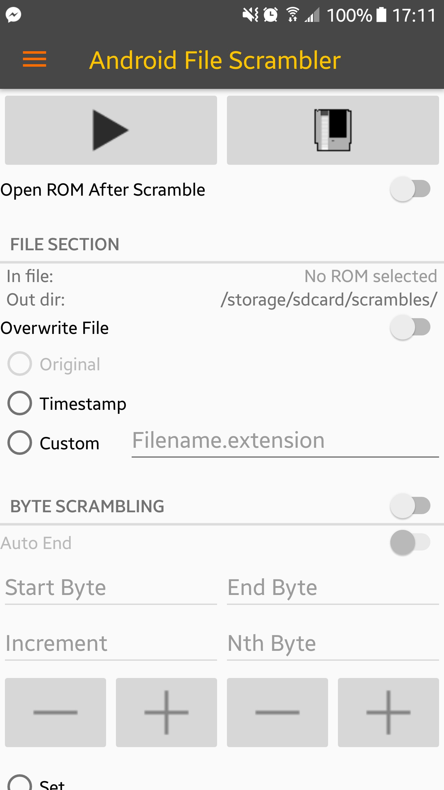
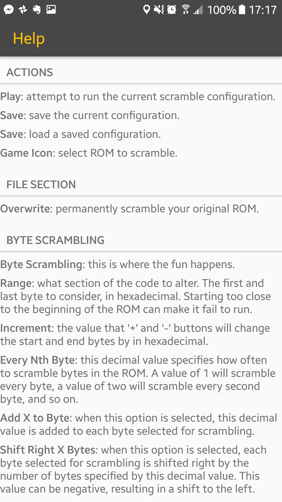

There is a streamer I used to watch where he would play old games on emulators but with a plugin that would randomize and corrupt live memory or ROM which would cause unpredictable and/or funny results, similar to how the real consoles would behave when tilting a cartridge while the game was running. There was a desktop app that was primarily used for this but I had been playing games I previously owned on my phone, and wanted to also be able to do the same thing on my phone.

## Tech Stack
Kotlin and Android SDK

## App Features
- Apply different math operations to static or parametric memory segments
- Different output options for different use cases (same file or timestamped, or custom output destination)
- The play button initiates Android to open an emulator with the output ROM
- Most of the same features as the desktop app

|||
|-|-|
|||

## Reception
Users appreciated having a mobile app but ran into a few different issues trying to use it, specifically crashes from permission or data issues.

## Lessons Learned
This is another app that I should have originally made as a web app so it would be lighter, easier to deploy, and more accessible than the Google Play Store. I also would integrate the help section into the UI so that it is clearer what help information relates to what UI element or concept.