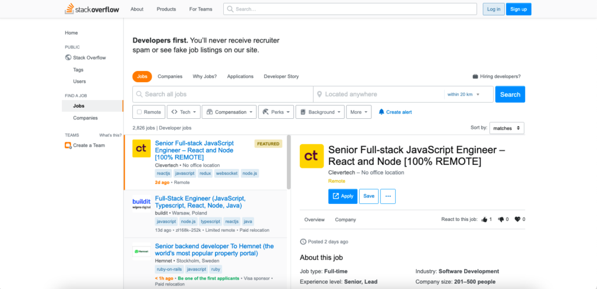

The "Jobs" and "Company Pages" side of Stack Overflow is a platform for developers and technologists to find, be matched with, or be found by potential future employers. There was also a Candidate Application Service web app / system that was sunset after I joined due to low use compared to external ATSs. A majority of the work was around jobs, company pages, dev story, and the ads. There was a lot of background work to pull in jobs and companies from different sources, interfacing with the sales system to offer different types of ads, and fulfilling ad contracts / quotas.

## Tech Stack
C# ASP.NET, HTML, CSS, JS/TS, SQL

## Jobs System
- API for pulling in data from different job sources
- Editor for manually configuring job ads and information
- Error handling, key management, API options
- Job Ad reservation purchases

## Company Pages System
- Editor for the public profile
- Candidate management and tracking, messaging
- Company posts, feed for users
- Company Ad reservation purchases

## Ad System
- Interfaced with Google Ads
- Built to be performant and secure
- Data heavy and relied on data teams for certain datasets
- Some matching data and analysis handled by this system internally
- Experiments for tracking best versions of ads
- Primarily job or company ads (in the future we added ed tech ads for courses)

## Screenshots

## Reception
Many users appreciated the system, both candidates and employers. I even used it to get my job at Stack Overflow and was using it to apply to other jobs before deciding on Stack. 

## Lessons Learned