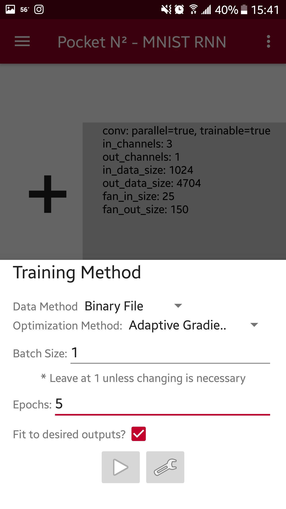
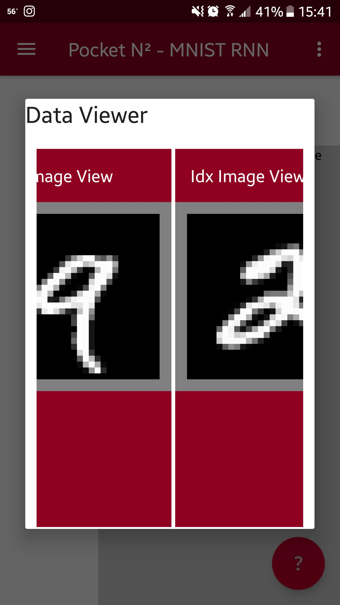

I wanted to mess around with machine learning models in a way that was more intuitive than code and configuration files. I could see that the orchestration and management of models in specific work contexts was a valuable tool, and I wanted to learn about them by building one. The idea to put it on Android was to make use of the camera, microphone, and additional sensors. While this is a fine setup, I wanted process persistence and availability not available on mobile devices, so later I migrated the app into a C# .net core website while leaving the original app working.

## Tech Stack
Android SDK + NDK (Kotlin + C++), existing neural network / ml library

## Architecture
- **Front-End: Kotlin + Android GUI**
- **Back-End: C++**

## Screenshots

||||
|-|-|-|
||||

## Reception
Some users tried using the app, but overall there were too many low-level bugs and differences in hardware / OS to fully diagnose and solve issues. A lot of devices probably cannot support these types of programs either. A model can be easily a few hundred MB to several GB, and most phones have only 16 GB or less of RAM. Newer phones have a NPU (neural processing unit) that eventually might be more widely available but is generally not supported yet.

## Lessons Learned
Like I mentioned earlier, I wanted process persistence and availability not available on mobile devices, so later I migrated the app into a C# .net core website while leaving the original app working. C++ is somewhat fragile compared to C# or Rust so it was prone to more issues despite the underlying libraries and frameworks being well tested. A touch screen is also not the best way to view and edit a large amount of UI elements including graph of nodes and edges.